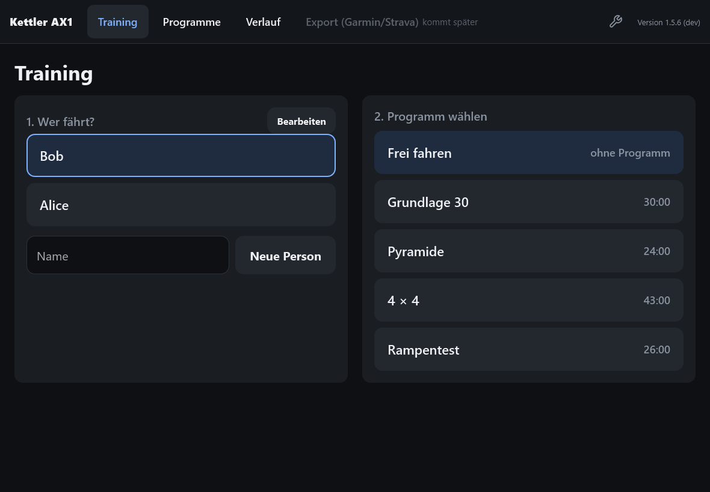
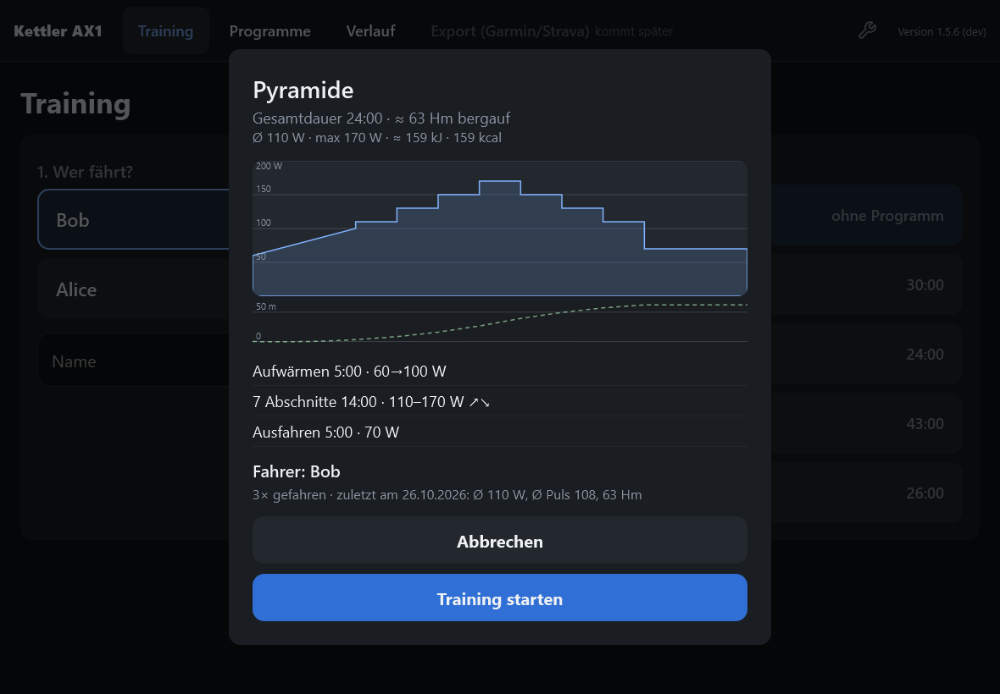
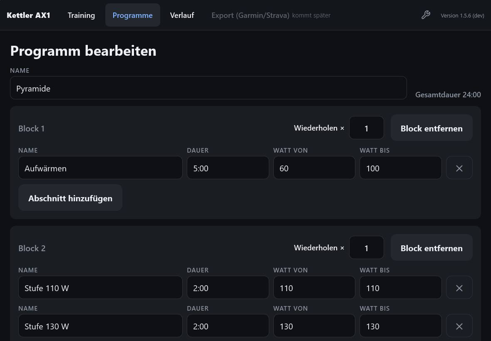
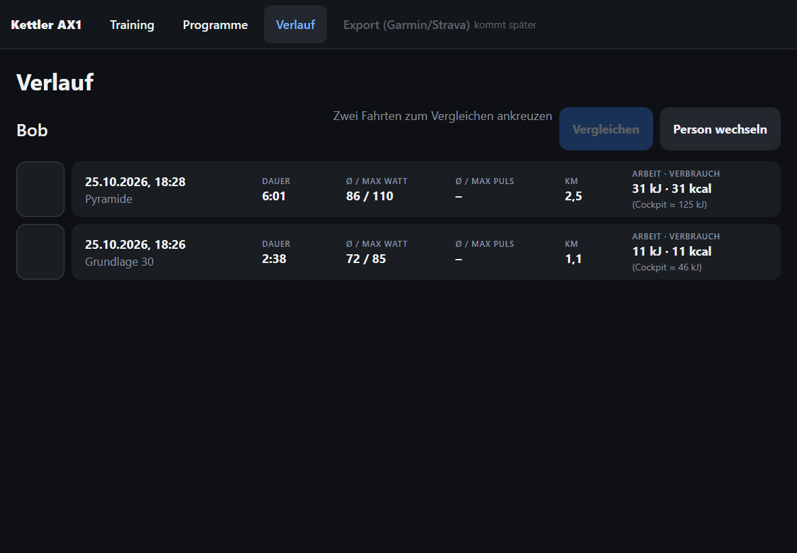
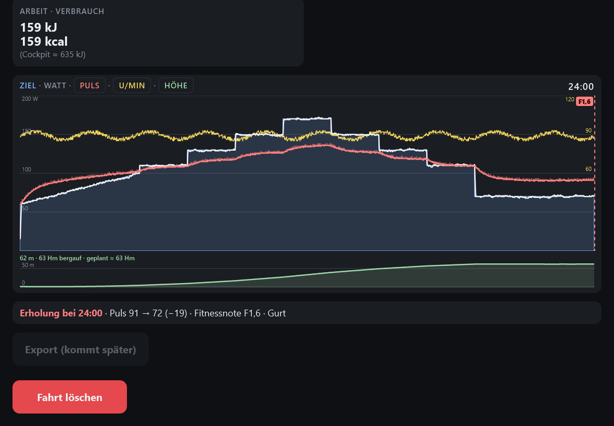
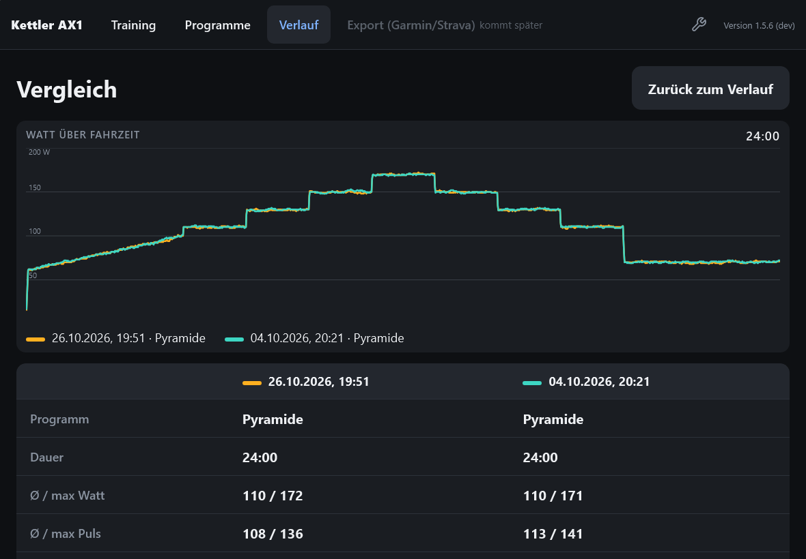
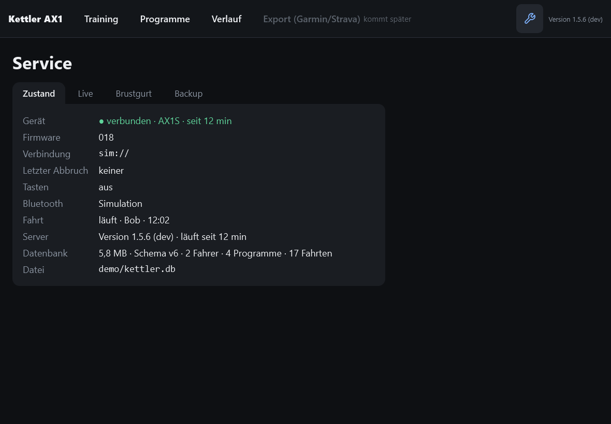
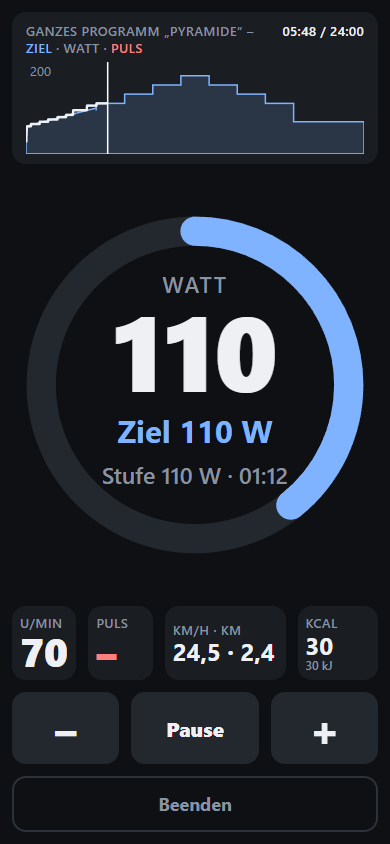

# Kettler AX1 – Training Server

A training server and web app for the Kettler AX1 ergometer (Siemens cockpit, RS232, built around 2002). The server talks to the ergometer over its serial port; the web app on iPad and iPhone shows live values, runs interval programs, controls the load and records every ride.

> **Mirror:** This repository is published from a private development repository, one commit per release. Issues are welcome; changes from pull requests are carried over there and come back with the next release.

> **Note:** The web app's user interface is German only.

*Training screen halfway through the program „Pyramide“ (recorded with the simulated ergometer and demo data).*

## Features

- **Live training:** power, target, cadence, pulse, speed, distance and energy, with a chart of the whole program and the part already ridden.
- **Interval programs:** blocks of steps with fixed or ramped wattage; the server sets the load on the ergometer second by second. Four templates included, own programs in the editor.
- **Cues:** 10 s before each step the iPad announces it („Noch 10 Sekunden, dann Erholung, 100 Watt“); where the power changes it also beeps at 3, 2, 1. The speaker button in the chart head switches between announcement and beeps, beeps only and off. iOS mutes the announcement in silent mode; the beeps still play.
- **Elevation:** the power is turned into a climb (per rider weight), with a planned profile before the start and the ridden one during the ride.
- **Riders:** several people with their own profile, history and chest strap.
- **History and comparison:** every ride with its key figures, a detail view with all curves, and two rides side by side.
- **Recovery measurement:** recovery pulse and fitness grade after a ride, from the cockpit's button or with the chest strap.
- **Chest strap:** a Bluetooth heart rate strap (e.g. Garmin HRM-Dual) read by the server, optional.
- **Handlebar keypad:** the AX1's four direction keys work during a ride: UP/DOWN ±10 W, RIGHT pause, LEFT switches the chart view, LEFT held for 2 s stops the ride.
- **Service page:** connection status, live trace of the device traffic, chest straps, backup and restore in the browser.

## How it fits together

One Rust program does everything. As `server` it runs the training logic, stores the rides in SQLite and serves the web app. The ergometer is plugged into the server's computer with a USB serial adapter, or into another PC that runs the same program as a `bridge` and passes the serial line on over the network. All devices that open the web app see the same ride.

## Screenshots

<table>
  <tr>
    <td align="center"> Choosing rider and program</td>
    <td align="center"> Program preview before the start</td>
  </tr>
  <tr>
    <td align="center"> Program editor</td>
    <td align="center"> A rider's history with key figures per ride</td>
  </tr>
  <tr>
    <td align="center"> Ride detail with elevation and recovery</td>
    <td align="center"> Comparing two rides</td>
  </tr>
  <tr>
    <td align="center"> Service page: status</td>
    <td align="center"> Training on the iPhone</td>
  </tr>
</table>

## Installation

Hardware, the ways to install it (Docker, systemd, Proxmox, bridge on Windows), configuration, backup and troubleshooting: see **[deploy/README.md](deploy/README.md)**.

## License

[MIT](LICENSE)
