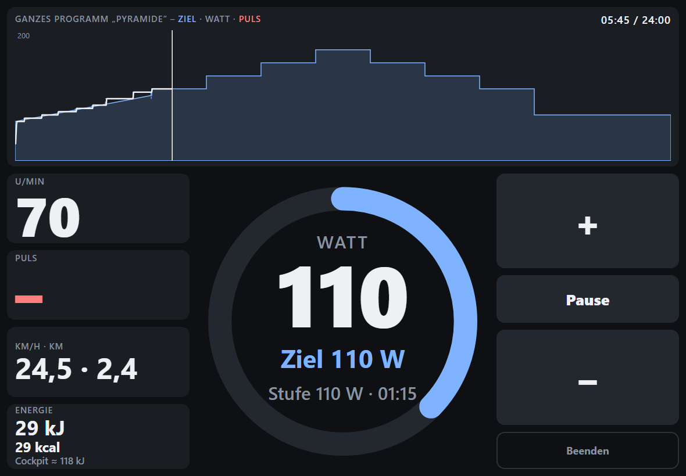
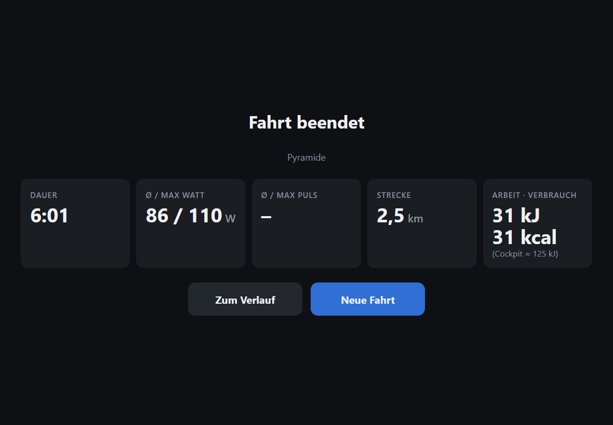
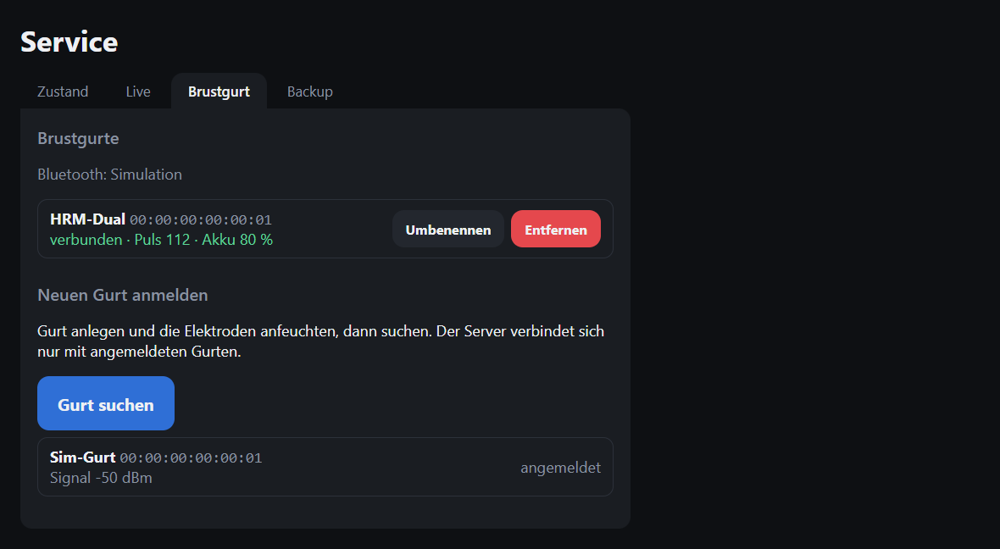

# Kettler AX1 – Training Server

A server written in Rust (runs in Docker on your home network) for a Kettler AX1 ergometer with a Siemens cockpit. It talks to the device over the serial port, either directly or through a small network bridge. A web app for iPad and iPhone shows live values, runs interval programs with fixed wattage targets, controls the load and records every ride.

> **Note:** The web app's user interface is German only. UI labels quoted in this README (e.g. „Bearbeiten“) are the German texts you will see on screen, with an English explanation next to them.



*Training screen during an interval program (recorded with the simulated ergometer).*

## Screenshots

<table>
  <tr>
    <td align="center"><br><sub>Training on the iPhone (portrait)</sub></td>
    <td align="center"><br><sub>Program preview before the start</sub></td>
  </tr>
  <tr>
    <td align="center"><br><sub>Program editor with the pyramid</sub></td>
    <td align="center"><br><sub>Summary right after the ride</sub></td>
  </tr>
  <tr>
    <td align="center"><br><sub>A rider's history with key figures per ride</sub></td>
    <td align="center"><br><sub>Comparing two rides</sub></td>
  </tr>
</table>

Cadence (rpm) appears in the history, the summary and the comparison (average / max per ride), and as a yellow line with its own axis on the right in the charts of the training screen and the ride detail. Pulse („Puls“) and cadence („U/min“) can be toggled in the legend, and hovering shows the value at that point in time. The average only counts seconds in which you actually pedal; older rides are recalculated from their samples when the database is upgraded (schema 3).

A recovery measurement (the cockpit's Recovery button) is stored with the ride (schema 4): during the ride at the current ride time, and up to 10 minutes after the end at the end of the ride. The training screen and the ride detail show it as a red dashed vertical line with the fitness grade (e.g. „F5,7“), the crosshair shows the grade and the pulse difference, and below the chart in the ride detail you find P1 → P2, the difference and the grade. It is deleted together with the ride.

## Elevation profile

The server derives an elevation curve from the power. Every active second changes the elevation by Δh = (actual watts − flat) ÷ ((weight + 10 kg) × 9.81): power above the “flat” value lifts you, below it you go downhill (also at 0 W during a ride), and the 10 kg stand for the bike. The elevation starts at 0 m, pauses change nothing.

- **Climb (Hm):** Counted with a threshold of 1 m: a climb only counts once the curve has risen at least 1 m since the last low point. Noise around the flat value therefore produces no climb.
- **Preview:** The curve is precomputed second by second from 0 m using the program's target watts (ramps linear) and shown as „geplant ≈ X Hm“ (planned) next to the strip. The program preview before the start shows the same strip for the selected rider (their weight and flat value) and „≈ X Hm bergauf“ (uphill); above it the average and highest target watts and the work at target (kJ/kcal), below it how often the rider has ridden the program and their figures from last time (matched by program name, finished rides only). Free rides have no preview; changes via +/− or the keypad only affect the ridden line. Example with 85 kg and flat 70 W: “4 × 4” ≈ 121 Hm, “Pyramide” ≈ 62 Hm.
- **Per rider:** Weight (default 75 kg, 30–250 kg, without bike) and flat value (default 70 W, 0–300 W) are under „Bearbeiten“ → „Profil“ (Edit → Profile).
- **Snapshot:** Every ride stores the weight and flat value from its start. Later profile changes do not alter old rides.
- **Display:** a green strip below the power chart with its own meter axis (dashed: preview, solid: ridden elevation), toggled with „Höhe“ (elevation) in the legend (remembered), a line „Höhe“ in the crosshair; a tile „Hm bergauf“ in the summary, „Hm“ in the ride list, strip and number in the ride detail, „Hm bergauf“ (A/B) in the comparison (without curves there).
- **Upgrading to 1.2.0:** The database is migrated to schema 5; existing rides get 75 kg / 70 W and their climb is recalculated. Back up the database first (see [Backup](#backup)).

## Status

Everything is built: server, simulation, bridge, web app (training, program editor, history) and Docker package. The protocol is confirmed on the real device, and the whole system passed acceptance on the real ergometer (2026-10-25, all tests passed). A new database contains four program templates (Grundlage 30, Pyramide, 4 × 4, Rampentest), and a ride ends by itself once the automatic pause has lasted 10 minutes.

The version is in `Cargo.toml` (currently 1.5.5). The web app shows it in small print as „Version 1.5.5 (abc1234)“ (at the end of the menu bar, on phones at the bottom of the training selection); the commit is baked in at build time via `KETTLER_GIT_SHA` (otherwise “dev”). `GET /api/version` returns `{"version":"1.5.5","commit":"abc1234"}`, `kettler --version` the same as text. After the server restarts with a new version, the page asks you to reload.

## Architecture

One Rust program (one binary, one Docker image) with three modes:

- `server`: Kettler protocol, training logic, recording, SQLite database, web UI and a websocket for live values.
- `bridge`: forwards a local serial port unchanged over TCP (port 4001) and reports the keypad buttons on a second port (4002). Runs on the computer the ergometer is plugged into.
- `simulate`: a simulated ergometer for development and testing without pedaling.

The connection to the device is chosen in the configuration, e.g. via `KETTLER_DEVICE`:

- `tcp://192.168.1.50:4001` (the usual case, to the bridge or later to a Wi-Fi module)
- `serial://COM3` (device on the same computer)
- `sim://` (simulation)

## Hardware

- Kettler AX1 with Siemens cockpit, serial 9600 baud, 8N1, commands terminated with `\r\n`.
- USB-RS232 adapter: FTDI recommended (no special driver, also works on Linux). The old Prolific PL2303HXA only works with Prolific driver 3.3.2.102; driver 3.9.6.0 blocks the chip.
- Optional later: a Wi-Fi bridge directly at the ergometer (Elfin-EW10A or ESP32 with MAX3232). Not decided yet.

## Protocol (quick reference)

| Command | Response / effect |
| --- | --- |
| `RS` | `ACK`, reset |
| `CM` | `ACK`, enable PC mode |
| `ID` | `AX1S` |
| `VE` | `018` (version) |
| `ST` | Status line with 8 tab-separated fields: pulse, rpm, km/h×10, distance, target watts, energy, time (mm:ss), actual watts |
| `PW <watts>` | Set the target power, answers with a status line |

Example `ST`: `000 066 234 001 080 0004 00:13 080`

Observed quirks:

- `CM` is only acknowledged while someone is pedaling. Without pedaling there is no answer.
- PC mode persists after `CM` + `ACK`, even across pedaling pauses and unplugging the USB cable.
- In PC mode `PW` also works at 0 rpm. Before the first `ACK` to `CM` the value is ignored.
- `PW` accepts 25–400 W in 5 W steps. Smaller values become 25, larger ones 400, values in between are rounded to the nearest step.
- The cockpit buttons keep working in PC mode and override the target watts. The value from `ST` is authoritative.
- Recovery button (recovery pulse): During the measurement the cockpit writes the time as `mm;ss` with a semicolon. Without a pulse it first shows `00;00` (the cockpit gives up after about 17 s); with a pulse it counts down from `00;59`. At `00;00` the pulse field holds the pulse difference P1 − P2 (e.g. `006`). The fitness grade the cockpit displays is not transmitted; the server computes it with the rule of thumb from the manual: grade = 6 − (10 × (P1 − P2) / P1)², clamped to 1.0 (very good) to 6.0 (insufficient). P1 is the pulse at the start of the countdown. The difference stays in the pulse field until the mode is left. `ST` is answered the whole time, and PC mode persists (measured 2026-10-25 with `tools/kettler_recovery_probe.py`). Meanwhile the server pauses a running ride, stores no samples, sends no power and shows a banner on every page with the remaining time, pulse and result (exercise pulse P1, recovery pulse P2 and the fitness grade). Pedaling on after the measurement resumes the ride.
- Distance in 0.1 km. Energy in kJ of body energy, about four times the mechanical work; mechanical work in kJ roughly equals kcal of body energy. The server computes distance and energy itself from the samples.

The web app shows energy as three numbers (training, history, comparison): **„Arbeit“** (work) in kJ is the mechanical work from the samples. **„Verbrauch“** (consumption) in kcal is the body energy using the rule of thumb for cycling (about 24 % efficiency, so 1 kJ of work ≈ 1 kcal). **„Cockpit“** in kJ is the value the ergometer display shows: about four times the work (measured on a real AX1: 18 kJ of work gave +71 device units).

## Handlebar keypad

A keypad with four direction buttons hangs on the same RS232 connector as the cockpit (via a Y cable). It sends no data; instead it switches the serial port's modem status lines and is powered via DTR and RTS: DOWN hangs on RTS, the other three buttons on DTR. Server and bridge set both lines when opening the port. Measured on 2026-10-26 with `tools/kettler_keypad_probe.py`:

| Button | Lines on |
| --- | --- |
| UP | CTS and RI |
| DOWN | DSR |
| LEFT | DCD |
| RIGHT | CTS only |

A line state only counts once it has been stable for 50 ms (sampled every 20 ms). This filters bounce and glitches. The buttons only act during a running ride, exactly like the buttons on the iPad:

| Button | Effect |
| --- | --- |
| UP / DOWN | target +10 W / −10 W immediately, after holding 600 ms again every 400 ms |
| RIGHT | pause / resume, triggered on release (never if the press turned into an UP) |
| LEFT short | toggle between the normal and the large chart view |
| LEFT hold | after 0.5 s the hint „Weiter halten zum Beenden“ (keep holding to stop) appears, after 2 s the ride ends (releasing afterwards does nothing) |

Without a running ride, in the summary, and when the keypad channel is lost (a pressed button then counts as released), nothing happens. While the keypad channel is up, the chart header shows the badge „Tasten“ (keys) in both views. It means “keypad channel connected” (with `tcp://` the connection to the bridge, with `serial://` the open port), not that a keypad is actually plugged in.

**Large chart view.** At the top the chart of the whole program, at the bottom a value bar with actual watts (target below), section with remaining time, pulse and rpm; on phones 2 × 2 tiles. The upcoming part of the program is dimmed. The view has no on-screen buttons; the pause hint names the key or the tap. Toggle it with a short LEFT or by tapping the chart (dragging still moves the crosshair). **All devices show the same view:** the server holds it, a tap or LEFT switches it on all open devices, and it stays for the next ride until the server restarts (then the normal view applies).

**Where the keys come from.** Via the bridge (`tcp://`) the bridge listens on a second port, default `0.0.0.0:4002` (`--keys-listen`), and sends text lines `press UP` and `release UP` (UP, DOWN, LEFT, RIGHT) plus a `ping` every 0.25 s. The server connects to the same host on port 4002 and treats 1 s without a line as lost. That way a stalled stream also ends as a loss (pressed key = released) before a short LEFT reaches the 2 s needed to stop. Up to four key clients can connect at the same time. With `serial://` the server reads the lines itself, with `sim://` there are no keys. The hold rules live in the server; the bridge only reports press and release. If a bridge runs without a keypad channel, the server keeps retrying quietly; rides run without keys as before. Update server and bridge together: an older bridge without `ping` would be considered silent.

**After switching to the FTDI adapter or to the mini PC**, run `python tools/kettler_keypad_probe.py [PORT]` once and confirm the mapping in the table above. So far it has only been measured with the PL2303.

## Chest strap (Bluetooth)

Since 1.5.0 the server reads a Bluetooth chest strap itself, for example the Garmin HRM-Dual (standard Heart Rate profile over Bluetooth LE). iPhone and iPad cannot do Bluetooth in the browser, so the server talks to the strap through BlueZ on the Docker host. Bluetooth is **optional**: without a dongle, without BlueZ, on Windows or without a registered strap, everything works as before with the pulse from the cockpit (ear clip or Kettler plug-in receiver).



**What it does:**
- **Both pulses are recorded**, the cockpit's („Ohr“, ear) and the strap's („Gurt“), once per second. Shown and used for average/max is the effective pulse: the strap if it has a value, otherwise the cockpit. The pulse tile names the source („Gurt · Ohr 70“). The ride detail lists average/max separately for strap and ear, and the chart shows the ear pulse dashed for comparison.
- **Recovery measurement with the strap:** The cockpit's recovery button or the button „Erholung messen“ (measure recovery; during the ride and shortly after in the summary) starts the measurement in the server. P1 is the strap pulse at the start, P2 the one after 60 s, the grade follows the same formula as the cockpit's. If the pulse rises, the difference counts as 0 (grade 6.0). The ride stays paused for the 60 s, even if the cockpit gives up after about 17 s without its own pulse. Pedaling and „Weiter“ (resume) do not resume it during that time; „Pause“ and „Beenden“ (stop) work as usual (the measurement is then stored with the finished ride). „Abbrechen“ (cancel) in the banner ends it without a result. If the strap pulse is missing at the end, the measurement counts as failed. If the cockpit measures at the same time with an ear clip, there are two entries, „Ohr“ and „Gurt“.
- **Which strap counts:** If the rider has a strap in their profile, only that one counts. Otherwise the one connected strap that belongs to no other rider counts. If several are free, the server takes none and says so. A changed assignment applies from the next ride.

**Setup on the Docker host** (tested on Debian 13 with a Realtek RTL8761BU dongle in a Proxmox VM):
1. Pass the USB dongle through to the VM: in Proxmox at the VM under Hardware → Add → USB Device, easiest by vendor and product ID. This works while the VM is running. Don't change settings of other USB devices (such as “USB3”) during a workout, or the ergometer may briefly lose its connection.
2. Install firmware and BlueZ. Realtek dongles need `firmware-realtek` from `non-free-firmware`; on Debian 13 the package source is in `/etc/apt/sources.list.d/debian.sources`:
   ```
   sudo sed -i '/^Components:/{/non-free-firmware/!s/$/ non-free-firmware/}' /etc/apt/sources.list.d/debian.sources
   sudo apt update && sudo apt install firmware-realtek bluez
   sudo modprobe -r btusb && sudo modprobe btusb
   ```
3. Check: `bluetoothctl show` lists a controller, and `bluetoothctl --timeout 20 scan le` finds the strap while it is worn (e.g. “HRM-Dual:…”). Pairing is not needed. If `sudo dmesg | grep -i bluetooth` shows a timeout (`tx timeout`), reloading `btusb` once more often helps.
4. Make the container's user (uid 10001) known on the host, otherwise D-Bus won't let it talk to BlueZ:
   ```
   sudo useradd --system --uid 10001 --no-create-home --shell /usr/sbin/nologin kettler
   sudo usermod -aG bluetooth kettler
   ```
5. Only on Ubuntu, Linux Mint and other hosts whose kernel checks D-Bus via AppArmor (tested on Linux Mint): Docker's default profile blocks the way to BlueZ there, and the status shows “An AppArmor policy prevents this sender …”. The profile `deploy/apparmor/kettler-bluez` is the default profile plus D-Bus, restricted to BlueZ. Load it on the host (survives a reboot):
   ```
   sudo cp kettler-bluez /etc/apparmor.d/kettler-bluez
   sudo apparmor_parser -r -W /etc/apparmor.d/kettler-bluez
   ```
   and set `KETTLER_APPARMOR=kettler-bluez` in the stack. Not needed on Debian.
6. In Komodo, add `compose.bluetooth.yaml` under “File Paths”. It only mounts the D-Bus socket `/run/dbus/system_bus_socket`; the container gets no extra privileges. Leave `KETTLER_BLUETOOTH` empty (automatic).
7. On the service page in the „Brustgurt“ tab, wear the strap, press „Gurt suchen“ (search), then „Anmelden“ (register). If there are several straps, pick your own under „Profil“ for each rider.

The tab shows the status („Bluetooth: bereit“ = ready, or „nicht verfügbar“ = unavailable, with a reason), every strap with connection, pulse and battery, and lets you rename and remove them. If connecting fails, the last reason is shown next to it („zuletzt: …“); it is also written to the log and to the „Live“ tab whenever it changes. The server only connects to registered straps and retries every few seconds after a drop. The HRM-Dual only holds **one** Bluetooth connection: while the server is connected, a phone cannot get the strap. A Garmin watch can keep listening via ANT+. If you need the strap on your phone, remove it in the tab; the server then releases it.

If the Bluetooth dongle was unplugged and replugged while running, „Gurt suchen“ still finds the strap but it no longer connects (BlueZ reports it as connected, the server as unreachable). A reboot of the host helps, or as a last resort `bluetoothctl remove <address>` and `sudo systemctl restart bluetooth`.

If searching or connecting fails with a D-Bus permission error, BlueZ needs its own rule for the user `kettler`. Create a file `/etc/dbus-1/system.d/kettler-bluetooth.conf` that allows the user `kettler` `send_destination="org.bluez"`, and reload the service.

For development without hardware there is `KETTLER_BLUETOOTH=sim`: a simulated „Sim-Gurt“ that can be found and registered and sends a fluctuating pulse (also on Windows).

## Test scripts

Python scripts for experimenting with the real device. Requires `pip install pyserial`. The port is optional (default `COM3`).

```
python kettler_test.py [PORT]          # connection test (RS, ID, VE, CM, ST)
python kettler_pw_test.py [PORT]       # test PW variants, pedal steadily for about 1 minute
python tools/kettler_probe.py [PORT]   # measurement script: PW grid, pedaling pause, reconnect, units
python tools/kettler_recovery_probe.py [PORT]  # recovery button: log ST during the recovery measurement
python tools/kettler_keypad_probe.py [PORT]    # keypad: log the modem lines CTS/DSR/RI/DCD (directly on the port only, not via the bridge)
```

`kettler_probe.py` also accepts URLs such as `socket://127.0.0.1:4001` (e.g. via the bridge) and expects someone to pedal (instructions come as a countdown, no Enter needed; `--wait-scale` scales the waiting times). `kettler_pw_test.py` and `kettler_probe.py` also write a log file (`kettler_pw_test.log`, `kettler_probe-YYYYMMDD-HHMMSS.log`). The scripts print German messages.

## Installation and operation

There are two ways to run it. Either the USB adapter is plugged directly into the computer running the server (variants A1 and A2, no bridge needed), or the server runs elsewhere and a bridge at the ergometer provides the connection (variant B).

### Variant A1: mini PC just for the Kettler, plain Linux without Proxmox

The simplest setup if the computer next to the ergometer is there only for this. Debian or Linux Mint; the FTDI USB-RS232 adapter is plugged directly into the PC and shows up as `/dev/ttyUSB0`. To check whether the adapter was detected:

```
ls /dev/serial/by-id/
dmesg | tail
ls -l /dev/ttyUSB0
```

**Device path.** The stable path from `/dev/serial/by-id/` is recommended, e.g. `serial:///dev/serial/by-id/usb-FTDI_FT232R_USB_UART_A1B2C3-if00-port0`. It stays the same even if other USB serial devices are plugged in or the adapter moves to another socket. `/dev/ttyUSB0` is shorter but can become `ttyUSB1` after replugging or with a second adapter. The examples below use `/dev/ttyUSB0`; the by-id path works the same everywhere.

The `dialout` group is only needed if you start `kettler server` by hand as your own user:

```
sudo usermod -aG dialout $USER     # log in again afterwards
```

It is not needed with Docker Compose (the group is in the image) or with the systemd service (`SupplementaryGroups=dialout`).

**With Docker Compose.** Install Docker, enable the variant A lines in `docker-compose.yml` (`KETTLER_DEVICE=serial:///dev/ttyUSB0` instead of the `tcp://` line, plus the commented-out `devices:` block) and start:

```yaml
    environment:
      - KETTLER_DEVICE=serial:///dev/ttyUSB0
    devices:
      - /dev/ttyUSB0:/dev/ttyUSB0
```

```
mkdir -p data && sudo chown 10001:10001 data
docker compose up -d --build
```

Caution: with a `devices:` entry the container won't start if the adapter is not plugged in at startup (Docker can't find the device). Without Docker, as a systemd service, the server keeps running and connects as soon as the adapter appears.

The container runs as user `kettler` (uid 10001) in the image's `dialout` group. If the device's group on the host does not match the image's `dialout` group, add `group_add` with the numeric group ID (`stat -c %g /dev/ttyUSB0`) to the compose file.

**Without Docker.** Copy the binary (`cargo build --release`) to `/usr/local/bin/kettler` and run it as a systemd service. Example `/etc/systemd/system/kettler.service`:

```ini
[Unit]
Description=Kettler AX1 training server
After=network.target

[Service]
User=kettler
SupplementaryGroups=dialout
Environment=KETTLER_DEVICE=serial:///dev/ttyUSB0
Environment=KETTLER_DB=/var/lib/kettler/kettler.db
ExecStart=/usr/local/bin/kettler server --listen 0.0.0.0:8080
Restart=on-failure
StateDirectory=kettler

[Install]
WantedBy=multi-user.target
```

Create the user first (`sudo useradd --system kettler`). Enable with `sudo systemctl enable --now kettler`.

### Variant A2: mini PC with Proxmox, server in an LXC container

A mini PC (e.g. Lenovo M910q with Proxmox) stands next to the ergometer with the FTDI adapter plugged into it. The server runs in an unprivileged Debian LXC into which the USB adapter is passed through. The `bridge` is not needed.

**1. Find the adapter (on the Proxmox host).** To check: `ls -l /dev/ttyUSB0` and `ls /dev/serial/by-id/`. The by-id path shows which adapter is behind `ttyUSB0`; `/dev/ttyUSB0` is what gets passed through here.

**2. Pass it through (Proxmox 8).** Add to `/etc/pve/lxc/<id>.conf` (or in the UI: Container → Resources → Add → Device Passthrough):

```
dev0: /dev/ttyUSB0
```

If the permissions inside the container are not enough (the device belongs to `nobody` there), add the options `gid=<GID>`, `uid=<UID>` or `mode=0666` to `dev0`, e.g. `dev0: /dev/ttyUSB0,gid=20` for the `dialout` group.

**3. Allow Docker in the LXC.** If Docker should run inside the container, it needs `nesting` and `keyctl` under Options → Features (in the config: `features: nesting=1,keyctl=1`). Then restart the container and check inside: `ls -l /dev/ttyUSB0`.

**4. Start the server.** Inside the LXC as in A1 with Docker Compose or a systemd service; as in A1 the `dialout` group is not needed there. If `ls -l /dev/ttyUSB0` inside the container shows a group or permissions the service doesn't have, adjust `gid=`/`mode=` on `dev0` (see above) or use `group_add` in the compose file.

### Variant B: server elsewhere, bridge at the ergometer

The server runs on a NAS or Docker host that is not next to the ergometer. At the ergometer, a PC runs the bridge, which forwards the serial port over TCP.

**Start the server with Docker.** Put the bridge PC's IP into `KETTLER_DEVICE=tcp://<IP>:4001` in `docker-compose.yml`, then:

```
mkdir -p data && sudo chown 10001:10001 data
docker compose up -d --build
```

The `chown` is needed because Docker would otherwise create `./data` as `root` and the server (user with uid 10001) could not open the database.

Without Compose: `docker build -t kettler .` and `mkdir -p data && sudo chown 10001:10001 data`, then `docker run -d -p 8080:8080 -v "$PWD/data:/data" -e KETTLER_DEVICE=tcp://192.168.1.50:4001 kettler`. To try it without a device: `-e KETTLER_DEVICE=sim://`.

**Start the bridge on Windows.** Copy `kettler.exe` (from `cargo build --release`, in `target/release/`) to the PC at the ergometer. The adapter's COM number is in Device Manager under “Ports (COM & LPT)”.

```
kettler.exe bridge --port COM3 [--listen 0.0.0.0:4001] [--keys-listen 0.0.0.0:4002]
```

By default the bridge listens on `0.0.0.0:4001` for the device data (change with `--listen`) and on `0.0.0.0:4002` for the keypad buttons (`--keys-listen`, see “Handlebar keypad”). At startup it opens the port once as a probe and logs a clear error if that fails; it keeps running anyway, so the adapter can be plugged in later. If port 4002 is already taken, it logs that as an error and runs without a keypad channel. On first start the Windows firewall asks; allow access on private networks. Or create a rule as administrator:

```
netsh advfirewall firewall add rule name="Kettler Bridge" dir=in action=allow protocol=TCP localport=4001
netsh advfirewall firewall add rule name="Kettler Bridge Keys" dir=in action=allow protocol=TCP localport=4002
```

Optionally start the bridge automatically at logon: in Task Scheduler create a task with the trigger “At log on” and the action “Start a program” with `kettler.exe` and the arguments `bridge --port COM3`.

Later the PC can be replaced by a Wi-Fi module directly at the ergometer (Elfin-EW10A or ESP32). For the server nothing changes: same URL `tcp://<IP>:4001`.

### Deployment with Komodo (from GitHub)

On every push to `main`, GitHub Actions (`.github/workflows/docker.yml`) runs the Rust and Node tests and then builds the image `ghcr.io/bnitsche/kettler-ax1` with the tags `latest`, `main` and `sha-<short>`. Komodo pulls this image and starts it with `deploy/compose.yaml`. The workflow can also be started by hand (Actions → Docker → Run workflow, also for other branches). It additionally builds `kettler.exe` for Windows and attaches it as the artifact `kettler-windows` to the workflow run (available for 30 days). The actions used are pinned by commit SHA (the version is in a comment next to it); in the development repository Dependabot proposes updates once a week as a grouped pull request.

**One-time setup in Komodo:**

1. Credentials (only needed if the repository or the GHCR package is private). For ghcr.io you need a classic Personal Access Token (classic PAT) with the scope `read:packages`; fine-grained tokens don't work with GHCR. In Komodo under Settings → Providers or registry accounts, add an account for the domain `ghcr.io` with your GitHub user and the token. If Komodo should read the compose file from a private repository, it also needs a git provider account for `github.com` with read access to the repository (scope `repo`, or a fine-grained token with “Contents: read”; fine-grained only works for this git account).
2. Create a stack. Source “Git Repo”: `bnitsche/kettler-ax1`, branch `main`, run directory `deploy`, file `compose.yaml` (Komodo's default name, the “File Paths” field can stay empty). Alternatively paste the compose file directly in the UI (“UI Defined”). Select the ghcr.io registry account for pulling images, if you created one. Under Environment add:
   - Bridge on a Windows PC: `KETTLER_DEVICE=tcp://<PC-IP>:4001`
   - USB adapter plugged directly into the Docker host (variant A): under “File Paths” add `compose.yaml` and `compose.serial.yaml`, set `KETTLER_DEVICE=serial:///dev/ttyUSB0` and `KETTLER_SERIAL` to the host path, e.g. `/dev/serial/by-id/usb-FTDI_FT232R_USB_UART_…-if00-port0` (default `/dev/ttyUSB0`). Inside the container the device is always `/dev/ttyUSB0`. If the device's group differs from 20 (`dialout`), set `KETTLER_SERIAL_GID` (`stat -c %g /dev/ttyUSB0`). The server then reads the keys itself; leave `KETTLER_KEYS` empty.
   - Chest strap via Bluetooth: additionally add `compose.bluetooth.yaml` under “File Paths” (see “Chest strap (Bluetooth)”).
   - Optional: `KETTLER_PORT` (default 8080), `KETTLER_ALLOWED_HOSTS`, `KETTLER_TAG`, `KETTLER_KEYS` (empty = automatic, `off` = no keys), `KETTLER_BLUETOOTH`, `KETTLER_APPARMOR`
3. Press “Deploy”. After a new push press “Deploy” again, or set up Komodo's polling for new images and automatic stack updates, or a webhook (the exact names differ between Komodo versions).

For a fixed version set `KETTLER_TAG=sha-<short>`, e.g. `sha-1a2b3c4`. Without it, `latest` applies. The image is only available after the workflow has run once (on `main`; to test a branch, set `KETTLER_TAG` to the branch tag, e.g. `feat-deploy`). If `KETTLER_DEVICE` is missing, the stack fails on purpose. `pull_policy: always` makes sure “Deploy” really pulls a new `latest`.

**Data and backup.** `deploy/compose.yaml` uses the named volume `kettler-data`, so no `chown` is needed. The easiest way to back up or move is the service page in the browser (see [Backup](#backup)). Backing up the whole volume by hand (the name is fixed to `kettler-data` in the compose file, though tools may prefix it with the stack name):

```
docker stop <container>
docker run --rm -v kettler-data:/data -v "$PWD:/backup" debian tar czf /backup/kettler-data.tgz -C /data .
docker start <container>
```

**Running with the bridge.** On the Windows PC at the ergometer:

```
kettler.exe bridge --port COM3 --listen 0.0.0.0:4001 --keys-listen 0.0.0.0:4002
```

Open ports 4001 (device) and 4002 (keys) in the Windows firewall (PowerShell as administrator):

```
New-NetFirewallRule -DisplayName "Kettler Bridge" -Direction Inbound -Protocol TCP -LocalPort 4001,4002 -Action Allow -Profile Private
```

Either build `kettler.exe` locally with `cargo build --release` or download it from GitHub under Actions → run → Artifacts (`kettler-windows`).

### On the iPad

Open `http://<server>:8080` in Safari, then Share → “Add to Home Screen”.

Important: keeping the display awake (Wake Lock) only works over https or `localhost`. Over plain `http` the screen does not stay on by itself. So on the iPad set Settings → Display & Brightness → Auto-Lock → “Never” while training.

### Host names (`KETTLER_ALLOWED_HOSTS`)

The server only accepts API requests (including reads) and the websocket for local host names. Without configuration, IP addresses, `localhost`, single names without a dot such as `nas`, and names ending in `.local`, `.lan`, `.home.arpa` and `.fritz.box` work. Any other names, e.g. behind a reverse proxy, go comma-separated and without port into `KETTLER_ALLOWED_HOSTS`, e.g. `KETTLER_ALLOWED_HOSTS=kettler.example.org,training.example.org`.

### Configuration

| Setting | Default | Meaning |
| --- | --- | --- |
| `KETTLER_DEVICE` | `sim://` (with a warning in the log) | connection to the device (`tcp://…`, `serial://…`, `sim://`) |
| `KETTLER_DB` | `./kettler.db` (in the Docker image `/data/kettler.db`) | path of the SQLite database |
| `KETTLER_ALLOWED_HOSTS` | empty | additional host names, comma-separated |
| `--listen` (server) | `0.0.0.0:8080` | address and port of the server |
| `KETTLER_KEYS` | empty | source of the keypad buttons: empty = automatic (`tcp://` device: same host, port 4002; `serial://`: the server reads the lines itself; `sim://`: none), `off` = no keys, `tcp://host:port` = this address. An invalid value prevents startup. |
| `KETTLER_BLUETOOTH` | empty | chest strap: empty or `auto` = try BlueZ over D-Bus (off on Windows), `off` = no Bluetooth, `sim` = simulated strap. An invalid value prevents startup. |
| `KETTLER_APPARMOR` | `docker-default` | only with `compose.bluetooth.yaml`: the container's AppArmor profile, `kettler-bluez` on Ubuntu and Linux Mint (see “Chest strap (Bluetooth)”) |
| `--listen` (bridge) | `0.0.0.0:4001` | address and port of the bridge for the device data |
| `--keys-listen` (bridge) | `0.0.0.0:4002` | address and port of the bridge for the keys |

### Shutdown

On Ctrl+C or `SIGTERM` (e.g. `docker compose stop`, `systemctl stop`) the server ends a running ride like „Beenden“ (stop), saves it, sets the ergometer to 25 W and waits at most about 3 s for that. Then it stops. For `SIGTERM` to reach the server inside the container, the compose file has `init: true`.

When connecting to the ergometer, the server sets the load to 25 W if no ride is running. A ride ends by itself if nobody starts pedaling within 10 minutes after the start. If the device doesn't answer for more than 5 s during a ride, that counts like a pedaling pause: if it comes back, the ride continues, otherwise it ends after 10 minutes. Rides without a single sample are not stored.

Riders and rides can be deleted: a ride in its detail view in the history („Fahrt löschen“, delete ride), a rider on the training screen via „Bearbeiten“ (edit); there a rider can also be renamed via „Profil“ and their weight and flat value set (`PUT /api/persons/{id}` with optional `name`, `weight_kg`, `flat_watts` and `strap_id`, `null` clears the strap assignment; invalid values give 422, an unknown rider 404, an empty `{}` 422 „Keine Änderung angegeben“; `GET /api/persons` returns the fields). Deleting also permanently removes all related samples (for a rider, additionally all their rides); a running ride cannot be deleted. Programs are not affected.

### Backup

**In the browser (since 1.3.0):** The service page `http://<server>:8080/#/service` opens with the wrench on the right of the menu (on phones the „Service“ tab).
- „Backup herunterladen“ (download backup) saves the whole database as `kettler-backup-YYYY-MM-DD-HHMM.db` (a plain SQLite file). This also works during a ride.
- „Backup einspielen …“ (restore backup) checks the file, shows how many riders, programs and rides it contains, and after confirmation replaces **all** of the server's data. Backups from older versions are upgraded; backups from a newer version and files that aren't a Kettler database are rejected. Restoring is blocked during a ride. Afterwards all open devices reload the page.
- **Moving to a new computer:** download the backup on the old server, start the new server, restore the backup there, done. The volume does not need to be copied.

**By hand:** All data is in `data/kettler.db`. The database runs in WAL mode, so the files `kettler.db-wal` and `kettler.db-shm` may sit next to it. For a backup, either stop the container first (`docker compose stop`) and copy all `kettler.db*` files, or take a consistent copy while running:

```
sqlite3 data/kettler.db ".backup 'kettler-backup.db'"
```

## Troubleshooting

- **First stop: the service page** `http://<server>:8080/#/service` (wrench in the menu):
  - „Zustand“ (status) shows whether the device is connected and since when, the last disconnect with its reason, device ID and firmware (`VE`), the USB adapter with serial number, the keypad channel, the running ride, the server version and the database.
  - „Live“ shows all of the device's readings, the four modem lines of the handlebar keys as lamps (only with a local serial port) and the raw traffic with timestamps: sent commands, answers, discarded lines, missing answers, keys and connection changes. „Anhalten“ (hold) freezes the list for reading. The server keeps only the last 200 entries, in memory.
  - „Backup“: see [Backup](#backup).
- **Adapter not detected:** Windows: look in Device Manager under “Ports (COM & LPT)” and note the COM number. Linux: `ls /dev/serial/by-id/` and `dmesg | tail`. The FTDI adapter needs no special driver.
- **Old Prolific PL2303HXA:** only works with driver 3.3.2.102. Driver 3.9.6.0 blocks the chip (error 433 when opening). Better use an FTDI adapter.
- **No answer from the device:** The cable to the cockpit may need a null-modem adapter (transmit and receive lines swapped). Try with and without a null-modem adapter, e.g. with `python kettler_test.py COM3`. Settings: 9600 baud, 8N1.
- **`CM` is not acknowledged:** The device only answers `CM` while someone is pedaling. Pedal steadily while testing.
- **“Access denied” when opening the port:** Another program holds the port, e.g. a second bridge, a test script or a terminal program. Close it and try again.
- **Server doesn't start, message “Error: opening /data/kettler.db” with “Caused by: unable to open database file”:** The data directory is not writable for the container user. Run `sudo chown 10001:10001 data`.
- **Server reports „Unbekannter Hostname“ (unknown host name):** Add the name to `KETTLER_ALLOWED_HOSTS` (see above).
- **Handlebar keys don't react:** Is a ride running (keys only act then)? With `tcp://`, open port 4002 on the bridge PC (firewall) and update the bridge together with the server; the chart header shows the badge „Tasten“ while the keypad channel is connected (that says nothing about whether a keypad is plugged in). `KETTLER_KEYS=off` disables the keys. With a new adapter, run `tools/kettler_keypad_probe.py`.
- **Server starts but shows no values:** Check with `KETTLER_DEVICE=sim://` whether the app itself works. Then check `KETTLER_DEVICE`, IP, port 4001 and the firewall on the bridge PC.

## Development

```
cargo test                                   # Rust tests
node --test web/lib/*.test.js                # web app tests (the directory form fails under Node 24)
KETTLER_DEVICE=sim:// cargo run -- server    # server with a simulated device, http://localhost:8080
cargo run -- simulate                        # simulated ergometer as a TCP server (127.0.0.1:4001)
```

In PowerShell set the environment variable with `$env:KETTLER_DEVICE = "sim://"`. The web app lives in `web/` and is embedded into the binary at build time.

## License

[MIT](LICENSE)
